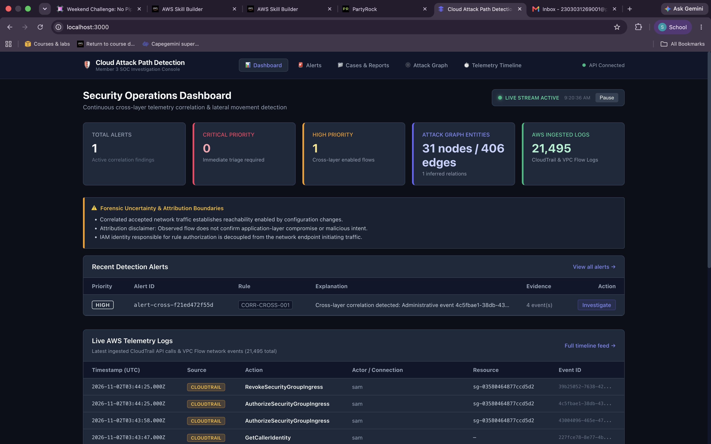
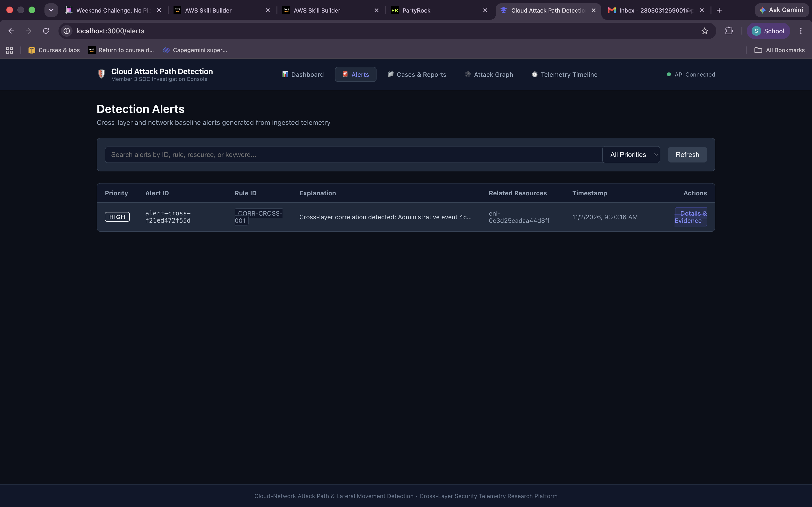
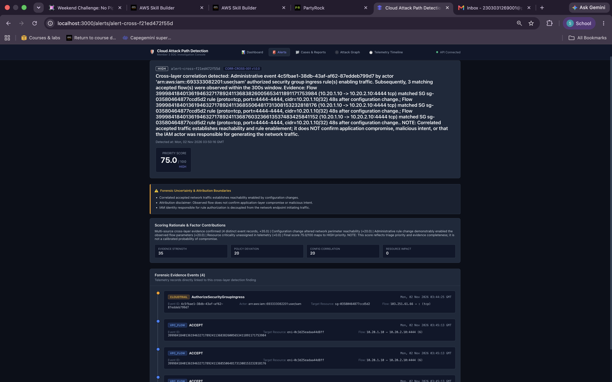
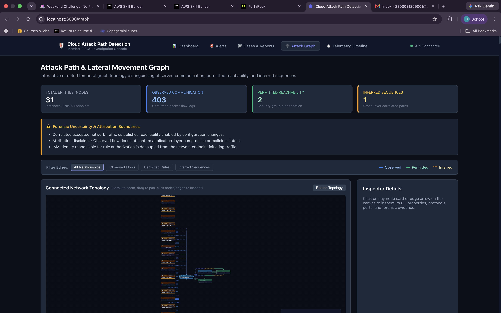
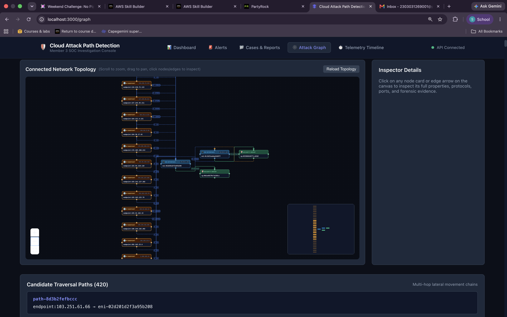
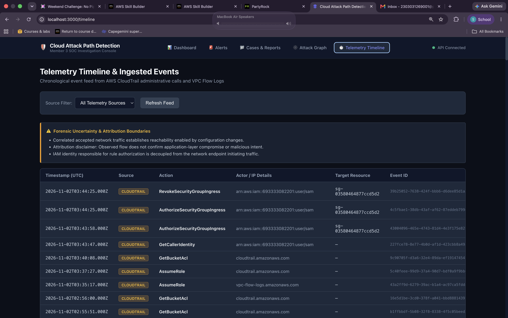

# Cloud-Network Attack Path & Lateral Movement Detection

A cross-layer security telemetry research platform that correlates AWS CloudTrail administrative events with VPC Flow Logs to detect, score, and explain lateral movement and attack paths within cloud infrastructure — without relying on network traffic alone.

This project evaluates a core hypothesis in cloud detection engineering: **network-only baselines miss attacks that originate from configuration changes.** A permissive security group rule is invisible to a flow-log-only detector until it is exploited — and by then, the signal is buried in noise. This platform instead watches both layers at once, and raises an alert only when an administrative change (e.g. opening a security group rule) is followed, within a tight temporal window, by network traffic that the new rule specifically enabled.

---

## Why Cross-Layer Correlation

Traditional network intrusion detection treats every accepted connection as equally uninteresting. But in cloud environments, **the interesting question isn't "was this traffic accepted?" — it's "was this traffic accepted *because someone just changed the rules*?"**

A connection that was always permitted is background noise. A connection that became possible 48 seconds after an `AuthorizeSecurityGroupIngress` call is a different story entirely — it's evidence that a configuration change was made and then immediately exercised, which is the signature of both legitimate operational changes and active lateral movement attempts.

This platform's detection engine specifically targets that second case.

---

## How It Works

```
┌─────────────────┐     ┌──────────────────┐     ┌────────────────────┐
│   AWS CloudTrail │     │   VPC Flow Logs   │     │  Resource Snapshots │
│ (admin API calls)│     │ (network traffic) │     │ (SG ↔ ENI mappings) │
└────────┬─────────┘     └─────────┬────────┘     └──────────┬──────────┘
         │                         │                          │
         └─────────────┬───────────┴──────────────┬───────────┘
                        ▼                          ▼
              ┌──────────────────────────────────────────┐
              │   Telemetry Collection & Normalization     │
              │   (SQLite: trail_events / flow_events)      │
              └───────────────────┬────────────────────────┘
                                   ▼
              ┌──────────────────────────────────────────┐
              │     Cross-Layer Correlation Engine         │
              │  • Extracts SG rule changes from CloudTrail │
              │  • Matches changes to attached resources   │
              │  • Verifies flows match the new rule's      │
              │    protocol, port range, and source         │
              │  • Enforces a strict 300s correlation window │
              │  • Checks for rule revocation before the flow│
              └───────────────────┬────────────────────────┘
                                   ▼
              ┌──────────────────────────────────────────┐
              │    Priority Scoring & Alert Generation     │
              │  Evidence strength · Policy deviation ·    │
              │  Config correlation · Resource impact       │
              └───────────────────┬────────────────────────┘
                                   ▼
              ┌──────────────────────────────────────────┐
              │   Temporal Graph Engine (NetworkX)          │
              │  Observed / Permitted / Inferred edge types │
              └───────────────────┬────────────────────────┘
                                   ▼
                    FastAPI Backend  →  React SOC Dashboard
```

### Detection Logic in Detail

1. **Ingestion** — CloudTrail management events and VPC Flow Log records are pulled, parsed, and normalized into a common schema, alongside periodic point-in-time snapshots of security groups, instances, subnets, and route tables.
2. **Rule extraction** — Administrative events that modify security group ingress rules are parsed into structured rule objects (CIDR-based or security-group-referenced).
3. **Resource resolution** — Each flow is matched against the actual security groups attached to its destination ENI, using the most recent snapshot — not just the rule's stated target.
4. **Temporal correlation** — A flow is only linked to a rule change if it occurred within a configurable window (default 300 seconds) *after* the change, and the rule was not revoked in between.
5. **Scoring** — Correlated findings are scored across four weighted factors (evidence strength, policy deviation, configuration correlation, resource impact) to produce a 0–100 priority score and HIGH/MEDIUM/LOW/CRITICAL classification.
6. **Attack graph construction** — All entities and relationships are assembled into a directed temporal graph distinguishing three edge types: **Observed** (confirmed packet flows), **Permitted** (security group authorization), and **Inferred** (cross-layer correlated sequences) — enabling analysts to trace multi-hop candidate traversal paths across the environment.

---

## Forensic Honesty by Design

Every alert and every graph edge in this platform is accompanied by an explicit uncertainty disclosure. The system deliberately avoids overclaiming:

- Correlated accepted traffic establishes **reachability enabled by a configuration change** — it does not confirm application-layer compromise or malicious intent.
- The IAM identity that authorized a rule change is tracked as **decoupled** from the network endpoint that later used it — the system never assumes they are the same actor.
- Every alert's scoring rationale lists exactly which factors contributed to its priority, and which fields (e.g. resource criticality) were missing from the underlying telemetry and therefore excluded from the score rather than guessed at.

This reflects the project's position that an attack-path detector's job is to **surface well-evidenced correlations for analyst triage**, not to issue verdicts.

---

## Key Features

### Security Operations Dashboard
A live operational overview showing total alerts, priority breakdown, attack graph entity/edge counts, and a real-time feed of ingested AWS telemetry — CloudTrail and VPC Flow Logs combined.



### Detection Alerts
Searchable, filterable alert list surfacing every cross-layer correlation finding with its priority, rule ID, explanation, and related resources at a glance.



Each alert expands into a full evidentiary breakdown: the triggering administrative event, every matched flow, the specific security group rule involved, the complete factor-by-factor scoring rationale, and a chronological forensic evidence timeline.



### Attack Path & Lateral Movement Graph
An interactive, zoomable, directed temporal graph of the environment's network topology, with edges visually distinguished by relationship type — observed communication, permitted reachability, and inferred cross-layer sequences.



The underlying topology view lets analysts inspect individual nodes (IP endpoints, ENIs, security groups) and edges directly, and surfaces candidate multi-hop traversal paths for further investigation.



### Telemetry Timeline
A full chronological, filterable feed of every ingested CloudTrail and VPC Flow Log event, for manual investigation independent of the automated detection pipeline.



### Cases & Reports
Alerts can be attached to investigation cases, which generate structured HTML incident reports suitable for handoff or recordkeeping.

---

## Architecture

| Layer | Technology |
|---|---|
| Telemetry collection | Python, boto3 (CloudTrail via S3, VPC Flow Logs via CloudWatch Logs, resource snapshots via EC2 API) |
| Storage | SQLite (local research/lab deployment) |
| Correlation & detection engine | Python, rule-based temporal correlation with revocation handling |
| Graph engine | NetworkX |
| Backend API | FastAPI |
| Frontend | React (TypeScript) |
| Scoring | Weighted multi-factor priority model |

---

## Getting Started

### Prerequisites
- Python 3.11+ and Node 18+
- An AWS account with CloudTrail (delivering to an S3 bucket) and VPC Flow Logs (delivering to a CloudWatch Logs group) already enabled
- An AWS CLI profile with read access to the above

### Configuration
Create `data/local/lab_config.json` (gitignored):
```json
{
  "profile": "your-aws-profile",
  "region": "ap-south-1",
  "log_group": "/your/vpc-flow-log-group",
  "trail_bucket": "your-cloudtrail-s3-bucket",
  "vpc_id": "vpc-xxxxxxxxxxxxxxxxx"
}
```

### Run

```bash
# 1. Install dependencies
python -m venv .venv && source .venv/bin/activate
pip install -e .

cd src/frontend && npm install && cd ../..

# 2. Collect telemetry
python -m src.ingestion.collectors.run_collect snapshot
python -m src.ingestion.collectors.run_collect trail
python -m src.ingestion.collectors.run_collect flow

# 3. Start the backend
uvicorn src.api.main:app --reload --port 8001

# 4. Start the frontend (separate terminal)
cd src/frontend && npm run dev

# 5. Trigger correlation
curl -X POST http://localhost:8001/alerts/refresh
```

Then open the dashboard at `http://localhost:3000`.

---

## Validation

The detection pipeline has been validated end-to-end against a live AWS lab environment consisting of an internet-facing bastion host and a private backend instance within the same VPC. A deliberately introduced security group rule change, followed by matching network traffic within the correlation window, was correctly identified, scored (75/100, HIGH priority), and fully evidenced — including the exact administrative event, the specific rule matched, and every corresponding flow record — confirming the correlation engine, snapshot resolution, and scoring model all function correctly against real telemetry rather than synthetic fixtures alone.

---

## Project Status

Final-year cybersecurity research project. Core cross-layer correlation, graph construction, scoring, API, and dashboard are functional and validated against live AWS telemetry. The ingestion layer currently performs full-window collection per run; incremental/cursor-based collection is a planned enhancement for production-scale deployments.
